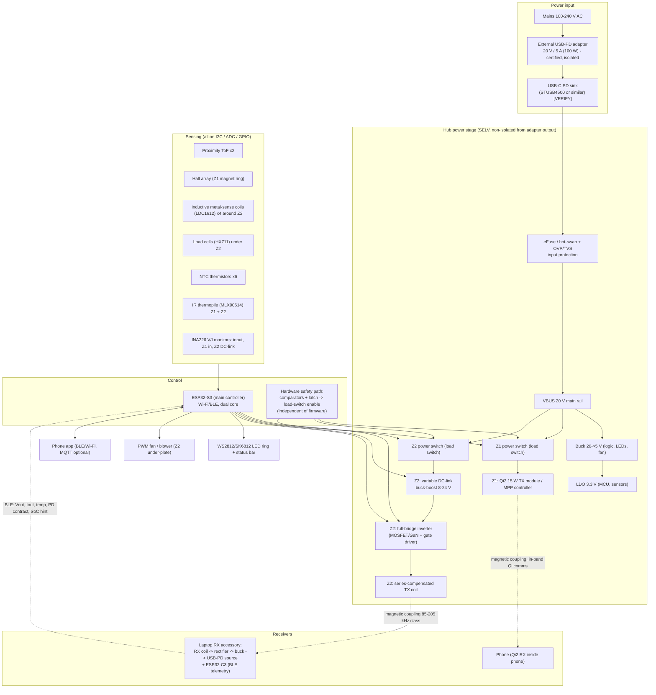

# PROJECT AURA — Part 1: System Architecture & Technical Feasibility

> Status legend used throughout the dossier
> - **[PROVEN]** shipping in commercial products / published standard
> - **[ENGINEERABLE]** standard building blocks, but you must design/validate the integration yourself
> - **[EXPERIMENTAL]** research-grade or no mainstream commercial precedent; expect iteration and possible failure
> - **[VERIFY]** a part number, price, rule or number I could not confirm here; check the vendor datasheet / regulator before relying on it

---

## 1. Product vision

AURA is a desk-mounted charging hub with **two physically separate charging zones**:

| Zone | Target | Technology | Maturity |
|---|---|---|---|
| **Z1 – Phone zone** | Qi2-capable phones (iPhone 15+/16+, Qi2 Android) and Qi phones | Qi2 Magnetic Power Profile (MPP), 15 W nominal | **[PROVEN]** |
| **Z2 – Laptop zone** | Laptops fitted with an **AURA receiver accessory** (or a native wireless-charging laptop) | Loosely coupled inductive / resonant power transfer, 45 W goal, 65 W stretch | **[EXPERIMENTAL]** |

**Key honesty point:** there is **no mainstream laptop wireless-charging standard in the market today**. Qi/Qi2 is a phone/accessory standard (≤ 15 W Qi2; Qi2.2 up to 25 W per WPC announcements **[VERIFY]**). A few laptops (e.g. Dell Latitude 7285 2-in-1 with a charging mat, ~2017) shipped with resonant wireless charging, and that ecosystem was small and discontinued **[VERIFY]**. Therefore AURA must ship Z2 together with a **receiver accessory** (a thin pad/sleeve that sits under the laptop and plugs into its USB-C port with a short pigtail on the *laptop side*; the hub's user-facing surface stays cable-free).

The zone separation is also a *safety and simplicity feature*: device class is known from the zone, then cross-checked with sensors (weight, magnet signature, receiver handshake). We do not need to "guess" phone vs. laptop from RF alone.

---

## 2. Overall system architecture



### Design principles
1. **Two independent power chains.** A Z2 fault never disturbs Z1 and vice-versa.
2. **Defence in depth.** Firmware protection (soft limits) **and** a hardware safety latch (comparators on overtemperature, overcurrent, overvoltage) that can cut each zone *without* the MCU.
3. **Use certified building blocks where regulation demands it.** For Z1 use a *Qi2-certified* TX module/pad in the prototype (WPC compliance is non-trivial). AURA's sensors *supplement* the module's own FOD; they don't replace it.
4. **Modular boards:** Main controller board, Z1 module, Z2 power board, Z2 coil assembly, sensor/LED daughterboards, laptop RX accessory.

---

## 3. Technical feasibility study

### 3.1 Why phone-class technology does not scale to laptops

| Challenge | Phone (Qi2, ~15 W) | Laptop (45–100 W) | Consequence |
|---|---|---|---|
| Power | 5–15 W | 45–100 W | 4–7× more power → loss heat scales; at 80 % efficiency a 65 W load wastes ~16 W as heat |
| Coil/receiver size | ~Ø45 mm coil, phone back | Need a large flat RX (≈ 150–250 mm) | Receiver must be a separate accessory or laptop redesign |
| Alignment | Magnets self-center (Qi2 ring) | Heavy, large device placed by hand; no magnetic centering standard | Larger tolerance needed → coil geometry, multi-coil or large-area design |
| Gap | ~2–4 mm (case + glass) | Laptop chassis (aluminium!) + keyboard deck/bottom case + feet: 3–10 mm | Metal chassis shields/absorbs the field and heats up — **biggest problem** |
| Chassis metal | Glass/plastic back | Often aluminium/magnesium unibody | Eddy-current loss, RX must be *outside* chassis (under feet / sleeve) |
| Frequency | 87–205 kHz | 100–205 kHz (inductive) or 6.78 MHz (AirFuel resonant) | Higher f → smaller coils but harder switching (class-E/EF), EMC, FOD |
| FOD | Standard power-loss accounting | A stray coin at 65 W can reach dangerous temp fast | Needs added metal detection + strict loss accounting |
| EM exposure | Low | Higher H-field in volume above pad | Must assess against ICNIRP/IEEE C95.1 limits |
| Standards | Qi/Qi2 (WPC) | None mainstream for laptops | You carry the compliance burden |
| Efficiency | ~70–80 % system | Realistically 70–82 % at best | Thermal design is the product |

### 3.2 Candidate technology pathways for Z2

| Option | Description | Pros | Cons | Verdict |
|---|---|---|---|---|
| **A. Loosely-coupled inductive, series-series, 85–205 kHz, large coils** | Full-bridge inverter drives a ~Ø150–200 mm spiral TX coil with ferrite backing; RX pad in accessory; RX rectifier → buck → PD source | Standard MOSFET switching, EMI manageable, lots of literature (SAE J2954-style principles scaled down, wearable/appliance WPT), DIY-able | k is modest (0.2–0.4); metal chassis matters; Qi comms not defined for this power → custom BLE/in-band control | **Recommended path for Prototype 2 [ENGINEERABLE]** |
| **B. Resonant 6.78 MHz (AirFuel Resonant / WiTricity-style)** | Class-E/EF amplifier, MHz coils, larger z-distance tolerance | Better spatial freedom; was used in early laptop products | RF design, ISM band rules, high switching losses, FCC/CISPR/ETSI RF compliance, India licensing check, few modules available | Research option only **[EXPERIMENTAL]** |
| **C. Qi 2.x/Ki-class standards stretched** | Use WPC's higher-power profiles | Standardised comms | WPC's higher-power ("Ki Cordless Kitchen") targets kitchen appliances (up to ~2.2 kW) **[VERIFY]**; no laptop profile | Not applicable today |
| **D. Native wireless laptop** | Laptop with built-in RX | Zero accessory | Essentially nonexistent in the market | Out of scope; support "if present" via standards-based handshake in future |

**Chosen pathway:** **Option A** for Prototype 2 and 3, with an *accessory receiver*. Option B is listed as a research track in `07_future.md`.

### 3.3 First-principles efficiency estimate (Option A)

Link efficiency upper bound (optimum load) for two resonant coils:

```
η_link,max = x / (1 + sqrt(1 + x))²     where   x = k² · Q_TX · Q_RX
```

| k | Q_TX = Q_RX | x | η_link,max |
|---|---|---|---|
| 0.30 | 100 | 900 | 93.6 % |
| 0.30 | 50 | 225 | 87.5 % |
| 0.20 | 50 | 100 | 81.9 % |
| 0.15 | 50 | 56 | 76.7 % |

Chain: `η_total = η_buck-boost × η_inverter × η_link × η_rectifier × η_buck/PD`

Example with realistic component efficiencies (0.97 × 0.96 × η_link × 0.95 × 0.96):

| η_link | η_total | Input power for 65 W out | Heat |
|---|---|---|---|
| 0.875 | ≈ 74 % | ≈ 88 W | ≈ 23 W |
| 0.936 | ≈ 80 % | ≈ 82 W | ≈ 17 W |

**Implications**
- Input adapter for 65 W out must supply ≥ ~90 W → **100 W (20 V/5 A) PD adapter** is the right input. 
- 45 W goal → ≈ 60 W input, ≈ 15 W heat: far more tractable. **Prototype 2 should hit 20 W → 30 W → 45 W before attempting 65 W.**
- 100 W+ is **not realistic for a compact desk unit without active liquid/heatsink-grade cooling and a bespoke RX**; mark as **[EXPERIMENTAL / not committed]**.

> These figures come from first-principles formulas with *assumed* Q, k and converter efficiencies; they are design targets to validate on the bench, not measured results.

### 3.4 Thermal feasibility
- 15–23 W dissipated across TX board, TX coil, RX coil, RX rectifier and the laptop's underside. Rule of thumb: keep any *user-touchable* surface ≤ ~43 °C (touch limits are material-dependent; see IEC 62368-1 / IEC TR 60721 touch-temperature tables **[VERIFY]**).
- Glass top plate is a poor conductor; heat must be removed from the *electronics side* via aluminium heat spreader + forced air (blower + vent slots at rear/bottom). The aluminium body acts as heat sink; ferrite sheets are a thermal barrier – leave thermal gap pads.
- Laptop battery safety: never exceed the laptop's own PD negotiation; the RX accessory is a *USB-PD source* so the laptop's charger IC controls the actual current.

### 3.5 Feasibility verdict

| Subsystem | Feasibility | Risk | Notes |
|---|---|---|---|
| Z1 Qi2 phone charging with sensors | High | Low | Integrate certified Qi2 TX module; add sensors for automation |
| Sensor fusion + state machine + app | High | Low | Mostly firmware work |
| Z2 20–30 W inductive link on bench | Medium-High | Medium | Coil design, resonance tuning, EMI |
| Z2 45 W with accessory RX | Medium | High | Thermal + efficiency + FOD |
| Z2 65 W | Low-Medium | Very high | Stretch goal |
| Z2 100 W+ | Low | Extreme | Not committed |
| Regulatory certification (BIS/WPC-ETA/EMC/FCC/CE) | Medium | High (cost/time) | Needed before any sale |
| Native laptop support | Very low today | n/a | Depends on industry |

**Go/No-Go recommendation:** Proceed with Prototype 1 (low risk, quick), run Prototype 2 as a time-boxed *engineering experiment* with explicit exit criteria (see `06_prototypes.md`), and only merge into the hub (Prototype 3) if Z2 achieves ≥ 30 W continuous at ≥ 70 % system efficiency with safe thermals.

---

## 4. Proven vs. experimental summary

| Item | Class |
|---|---|
| Qi2 15 W MPP charging via certified TX | PROVEN |
| Hall-sensor magnet detection, ToF proximity, NTC/IR thermometry, INA226 power metering, load cells | PROVEN |
| Multi-coil inductive metal detection (LDC1612) as supplemental FOD | ENGINEERABLE |
| Series-series inductive link at 100–205 kHz, 20–45 W | ENGINEERABLE |
| RX accessory as USB-PD source for laptop | ENGINEERABLE (PD source IC integration) |
| 65 W continuous in compact hub | EXPERIMENTAL |
| 6.78 MHz resonant laptop charging | EXPERIMENTAL |
| Auto-identification of laptop class by RF alone | EXPERIMENTAL (we use zone + weight + BLE handshake instead) |
