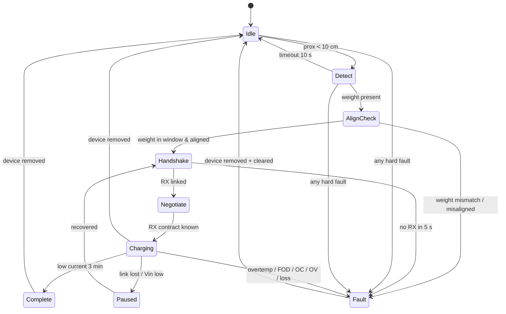

# PROJECT AURA — Part 4: Firmware & Software Architecture

Code lives in `aura/firmware/`:
- `core/aura_core.{h,cpp}` — **hardware-independent** state machine, protections, derating, loss accounting. **Compiled and unit-tested on a PC** (`test/test_core.cpp`, 13 scenarios pass).
- `aura_hub/aura_hub.ino` — ESP32-S3 HAL skeleton (INA226, NTC, MLX90614, HX711, watchdog, fan). **Not compiled for ESP32 or run on hardware.** ToF, Hall, LDC1612, BLE, LEDs are TODO stubs.

Run the logic tests:
```bash
cd aura/firmware && g++ -std=c++17 -Wall -Wextra -o /tmp/aura_test test/test_core.cpp core/aura_core.cpp && /tmp/aura_test
```

## 1. Software layers
```
 App (BLE/Wi-Fi) ── protocol (JSON over BLE GATT / MQTT optional)
 ───────────────────────────────────────────────
 Supervisor: per-zone ZoneController (state machine, limits, derating)   ← core/ (tested)
 Power control: soft-start ramp, DC-link setpoint, efficiency calc       ← to write
 Drivers (HAL): INA226, LDC1612, ToF, Hall(ADC), NTC(ADC), MLX90614, HX711, LED, fan, GPIO
 RTOS: FreeRTOS tasks pinned to cores
 Hardware safety latch (independent of firmware)
```
Task plan (ESP32-S3, FreeRTOS): 
| Task | Period | Core | Purpose |
|---|---|---|---|
| `electrical` | 5–10 ms | 1 | INA226 V/I, trip checks, ramp |
| `control` | 20 ms | 1 | ZoneController.step for Z1, Z2 |
| `thermal` | 100 ms | 0 | NTC/IR, fan curve |
| `presence` | 100–250 ms | 0 | ToF, weight, Hall, LDC |
| `comms` | 100 ms | 0 | BLE RX link, app, logging |
| `led` | 33 ms | 0 | animations |
Watchdog: task WDT 2 s; on reset every enable pin defaults LOW via pull-downs.

## 2. Major functions (core)
| Function | Role |
|---|---|
| `ZoneController::step(in, now)` | One control tick: global fault check → state handling → returns `Outputs` (TX enable, power limit, fan duty, LED, fault) |
| `checkHard()` | Immediate-stop faults: HW latch, sensor failure, overtemp (coil/FET/surface), overvoltage, hardware FOD or LDC metal delta |
| `derate()` | Linear power reduction from 60 °C to 72 °C |
| Loss accounting (in `Charging`) | If (Pin − Prx)/Pin > 30 % for > 2 s ⇒ `LowEfficiency` fault (suspect hidden metal) |
| Charge-complete | RX current < 0.15 A for 180 s ⇒ `Complete` |
| `clearFault()` | Latched fault clears only if device removed, HW latch cleared, conditions normal |

Defaults (`Limits`) are **starting values to tune on the bench**, not validated thresholds.

## 3. State machine


## 4. Power control (to implement)
- **Z1:** the Qi2 module regulates power itself via Qi control packets. AURA only enables/disables the 20 V rail and reads status. Don't try to override Qi power control.
- **Z2:** loop = RX reports (Vout, Iout) over BLE at ≥ 20 Hz → controller adjusts DC-link voltage (`powerLimitW` and RX demand) with a slew-rate limit (e.g. ≤ 5 W/s) and soft start from ~5 W. A BLE link-loss timeout of ≤ 500 ms ⇒ inverter off (RX also has output UVLO so it never back-feeds power into the laptop unregulated).
- Efficiency η = Prx / Pin computed on filtered values (1 s window).

## 5. Communication protocols
| Link | Protocol | Notes |
|---|---|---|
| Z1 TX ↔ phone | Qi/Qi2 in-band (handled in module) | Not implemented by AURA MCU |
| Hub ↔ laptop RX accessory | BLE GATT custom service: `status` notify (Vout, Iout, Trx, contract, flags), `ctl` write | Add pairing + signed/CRC frames; link-loss ⇒ stop |
| Hub ↔ app | BLE GATT / Wi-Fi + MQTT (TLS) | Read-only telemetry first; commands (stop/limit) authenticated |
| Debug | USB-CDC serial, JSON lines | |
Example telemetry JSON:
```json
{"zone":2,"state":"Charging","pin_w":61.2,"prx_w":48.9,"eff":0.80,"temp_coil":52.1,"temp_fet":58.4,"fault":0}
```

## 6. App integration (optional)
Live per-zone power/efficiency/temperature, charge-complete and fault notifications, firmware OTA (signed images; ESP-IDF secure boot/flash encryption for product), user limits (e.g. cap Z2 at 30 W for "quiet mode"). Suggested stack: Flutter/React-Native BLE client; MQTT only if cloud features are really needed.

## 7. Testing strategy
1. Host unit tests of the core (done).
2. Hardware-in-the-loop with simulated sensor values over serial (inject faults).
3. Fault-injection on bench: hot-air on NTC, aluminium coin on pad, unplug RX BLE, brown-out the input.
4. Verify that the **hardware latch trips with MCU halted** (ensure safety does not depend on firmware).
